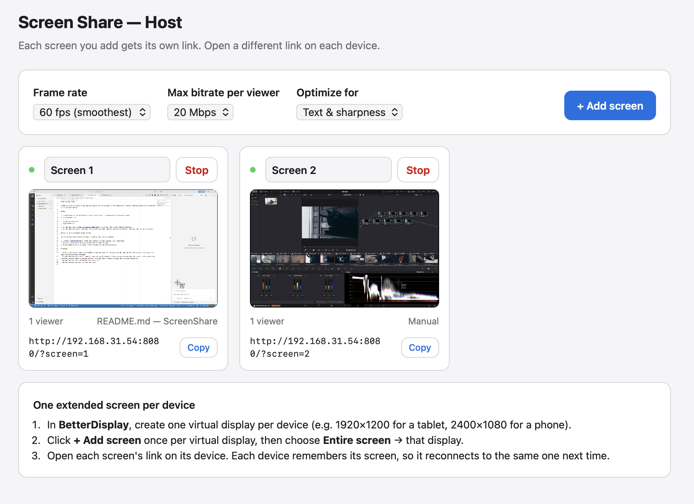

# Mac Screen Share for (iPad, iPhone, Android, TV, Projector, anything)

Stream your Mac's screens to Android devices (or any browser) on the same Wi-Fi. Each device can show a different screen. Nothing needs to be installed on the devices.

## Run

1. Install Node.js 18+ on the Mac (`brew install node`, or download it from nodejs.org).
2. In Terminal, run `node server.js` in this folder.
3. On the Mac, open **http://localhost:8080/host** in Chrome.
4. Click **+ Add screen** once for each device and choose what to share.
5. On each device, open that screen's link, e.g. `http://192.168.31.244:8080/?screen=1`. Each screen card shows its link with a Copy button.
   - Opening just `http://<mac-ip>:8080` shows a list of live screens to choose from.
   - Each device remembers its screen and reconnects to it automatically.
   - Tap the video to show **Switch screen** and **Fullscreen**.

## Sound

1. On the host page, click **Share Mac sound**.
2. In Chrome's picker, choose **Entire screen** (any display) and turn on **Share system audio**.
3. Every device on every screen now gets all of the Mac's sound. On a device, tap once to turn sound on (browsers block sound until a tap). Use **Mute** in the device's toolbar to silence that device.

Chrome on a Mac can only capture all system sound, not one window's sound. Click **Stop sound** to stop sending it.

## Notes

- Video goes peer-to-peer over WebRTC using hardware encoding. Each viewer gets its own encoded stream, so many viewers at high bitrate will load the Mac.
- Screen numbers stay stable. If you stop Screen 1 and add a new screen, it becomes Screen 1 again and its device reconnects.
- If a device can't connect: make sure your terminal app and Chrome are allowed under System Settings → Privacy & Security → Local Network. Also check for VPN or security software on the Mac.
- `PORT=9000 node server.js` changes the port. `DEBUG=1 node server.js` logs connection details.
